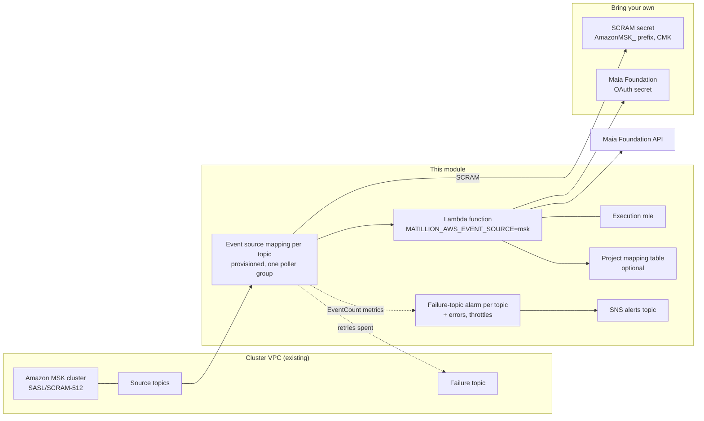

# Amazon MSK → Maia Foundation pipeline-execution Lambda adapter

Optional add-on that consumes records from Amazon MSK topics and triggers a Maia
Foundation pipeline for each one via the Maia Foundation pipeline-execution API. Each
record carries one message in the same format as an SQS body for
[`sqs-dpc-adapter`](../sqs-dpc-adapter), so one record triggers one pipeline run.

The handler is the same **arm64 container image** as `sqs-dpc-adapter`
(`var.image_uri`); this module only provisions the surrounding AWS resources.

## What it creates



- Lambda function (container image, arm64) + execution role scoped to the
  mapping table, the Maia Foundation secret, the cluster, the SCRAM secret and its KMS key,
  plus the AWS managed `AWSLambdaMSKExecutionRole`, which covers cluster discovery
  and the pollers' network interfaces.
- One event source mapping per topic, in provisioned mode, all in one poller group.
- Optional DynamoDB project-mapping table.
- CloudWatch log group; optional SNS topic + alarms (records reaching the failure
  topic, per topic; Lambda errors/throttles).

The cluster, topics, SCRAM secret, KMS key, failure topic and Maia Foundation OAuth secret are
always bring-your-own. The project-mapping table can be created
(`create_mapping_table = true`) or referenced (`existing_mapping_table_name`,
`existing_mapping_table_arn`).

## Usage

```hcl
module "msk_maia_foundation_adapter" {
  source      = "../../modules/aws/lambda/msk-maia-foundation-adapter"
  aws_region  = "eu-west-1"
  image_uri   = "123456789012.dkr.ecr.eu-west-1.amazonaws.com/maia-queue-adapter:current"
  secret_name = "matillion-maia-foundation"

  cluster_arn       = "arn:aws:kafka:eu-west-1:123456789012:cluster/orders/abc-1"
  topics            = ["orders", "refunds"]
  scram_secret_arn  = "arn:aws:secretsmanager:eu-west-1:123456789012:secret:AmazonMSK_maia-AbCdEf"
  scram_kms_key_arn = "arn:aws:kms:eu-west-1:123456789012:key/11111111-2222-3333-4444-555555555555"
  failure_topic     = "maia-trigger-failures"
}
```

Copy the image into your own ECR first, as for `sqs-dpc-adapter`: Lambda only runs
an image from a private ECR repository in the function's region.

## Message payloads

Each record's value is one message in the adapter's format (UTF-8 JSON); the key
and headers are ignored. One record starts one pipeline run:

```json
{
  "project": "CustomerDataPipeline",
  "environment": "prod",
  "job": "orders/LoadOrder",
  "variables": { "orderId": "42" }
}
```

`project` and `environment` are resolved to a project ID through the mapping
table, and `variables` are passed to the pipeline (each value up to 10,000
characters; the whole message up to 64 KB). The message is a trigger, not data:
the pipeline it starts reads and loads its own data.

### Topics that carry their own payload

A producer that sends its own payload rather than the format above is routed by
topic instead. `topic_routes` names the pipeline each such topic triggers, and the
record value reaches it base64-encoded in one scalar variable:

```hcl
  topic_routes = {
    orders = {
      project          = "CustomerDataPipeline"
      environment      = "prod"
      pipeline         = "mskLoad/LoadOrderEvent"
      payload_variable = "orderEvent"
    }
  }
```

A record on `orders` with the value
`{"eventType": "OrderPlaced", "orderId": "A-1001"}` starts
`mskLoad/LoadOrderEvent` with these scalar variables:

| Variable | Value |
|---|---|
| `orderEvent` | the base64 of `{"eventType": "OrderPlaced", "orderId": "A-1001"}` |
| `kafkaTopic` | `orders` |
| `kafkaPartition` | the record's partition |
| `kafkaOffset` | the record's offset |

The pipeline decodes the payload with `BASE64_DECODE_STRING` and parses it itself;
base64 keeps a backslash or quote in the payload from breaking the pipeline's SQL.
The mapping can deliver a record more than once, so a pipeline that inserts rows
should deduplicate on topic, partition and offset. Base64 grows the value by a
third, so the 10,000-character scalar-variable limit leaves about 7,500 bytes of
payload. A topic left out of `topic_routes` must carry the adapter's format.

The maia-queueing-adapter repository's `docs/MSK-TOPIC-ROUTES.md` walks through
routing a topic, building its pipeline and landing a row in Snowflake.

A record whose retries are spent is written to `failure_topic` with its content,
for example:

```json
{
  "timestamp": "2026-11-16T15:46:17.629Z",
  "version": "1.0",
  "requestContext": {
    "functionArn": "arn:aws:lambda:eu-west-1:123456789012:function:matillion-maia-msk-adapter",
    "condition": "RetryAttemptsExhausted",
    "approximateInvokeCount": 4
  },
  "KafkaBatchInfo": {
    "batchSize": 1,
    "recordsInfo": {
      "orders-0": { "topic": "orders", "partition": 0, "firstRecordOffset": 42, "lastRecordOffset": 42 }
    }
  },
  "payload": "{\"records\":{\"orders-0\":[{\"topic\":\"orders\",\"partition\":0,\"offset\":42,\"value\":\"<base64 of the message>\", ...}]}}"
}
```

The maia-queueing-adapter README has the full format, the event Lambda delivers
and the handler's partial batch response.

## Requirements

- **AWS provider 6.28.0 or later and Terraform 1.9 or later.** The provider is the
  first to accept a `kafka://` failure destination and a poller group. This is why
  MSK is a separate module: `sqs-dpc-adapter` and the `runner/aws/ecs` and
  `runner/aws/eks` roots stay on provider 5.x.
- **An adapter image that has the MSK source** — `maia-queueing-adapter` 1.2.0 or
  later. The module sets `MATILLION_AWS_EVENT_SOURCE = "msk"`, which only such an
  image reads. An older image reads an MSK event as an empty SQS batch and reports
  success, so the mapping commits the offsets and those records never trigger a
  pipeline. `image_uri` cannot be version-checked, so this is on the operator.
- **For `topic_routes`, the image must be 1.3.0 or later.** 1.2.0 reads MSK records
  but ignores `MATILLION_MSK_TOPIC_ROUTES`, so a routed topic's raw payload is read
  as the adapter's envelope, fails validation, and every record goes to the failure
  topic. Leave `topic_routes` empty on an earlier image.
- **SASL/SCRAM-512.** The secret's name must start with `AmazonMSK_` and it must be
  encrypted with a customer managed KMS key, as MSK requires. If the cluster
  enforces Kafka ACLs, the user needs DescribeConfigs on the cluster, and Describe
  and Read on each topic and on each consumer group (the `consumer_group_ids`
  output). Failed records are written to `failure_topic` as the same user, so it
  also needs write access there; the Lambda documentation doesn't list the exact
  ACLs for this, but a Kafka producer needs at least Write and Describe.
- **Networking.** The pollers run in the cluster's VPC and only talk to the
  brokers, so provisioned mode needs no NAT gateway or VPC endpoints. The function
  itself is outside the VPC and reaches DynamoDB, Secrets Manager and the Maia Foundation API
  over public endpoints.

## Behaviour

- **Failures.** A record that fails, including one the API rejects outright, is
  retried `maximum_retry_attempts` times and then written, with its content, to
  `failure_topic`, which must already exist. The first failure in a partition
  holds the rest of that partition until it is settled, because a retry
  redelivers everything from the lowest failed offset. With `batch_size = 1` a bad
  record holds back only itself.
- **Alarms.** With `create_alarms`, each topic gets an alarm that fires when a
  record reaches the failure topic or is dropped because it can't be written
  there. The Lambda errors alarm doesn't see these failures, because the function
  reports them in its response rather than raising. For a `topic_routes` topic this
  alarm covers only failures to _start_ a run; a record whose run starts and then
  fails inside the pipeline is not retried and never reaches the failure topic, so
  no alarm fires. Watch those in the pipeline's run history in Maia (see
  `maia-queueing-adapter`'s `docs/MSK-TOPIC-ROUTES.md`).
- **Scaling.** Concurrency is capped at one invocation per partition, so the
  topics' partition counts set the ceiling for a burst. `reserved_concurrency` is
  unreserved by default; if you set it, it is one cap shared by every topic and
  must be at least the total partition count.
- **Cost.** Provisioned mode is billed in event poller units for as long as the
  mappings exist. All of this module's mappings share one poller group (at most
  100 mappings, 2,000 pollers in total), so they share units instead of each topic
  being billed for its own.
- **Renaming the function** recreates the mappings with new consumer groups,
  which start from `starting_position` rather than the old groups' offsets.
